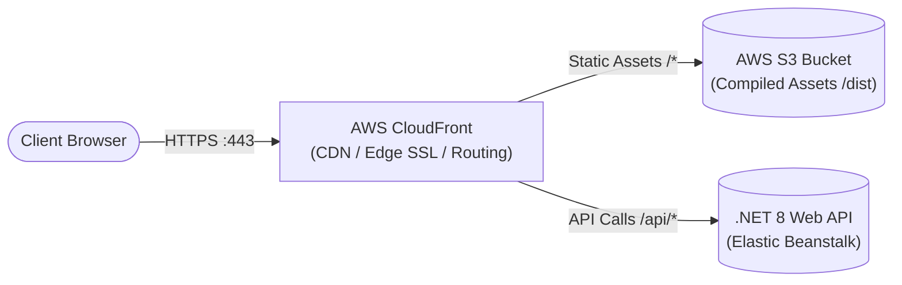

# ⚛️ Axel Linares - Portfolio Frontend (React + Vite SPA)

[](https://react.dev/)
[](https://www.typescriptlang.org/)
[](https://vitejs.dev/)
[](https://tailwindcss.com/)
[](https://aws.amazon.com/)

*High-performance, modern Single Page Application (SPA) designed as an interactive, ATS-compliant bilingual portfolio. Built with modern React patterns, strict TypeScript typing, Tailwind CSS, and seamless integration with the .NET 8 Web API backend.*

---

🌍 **[English](#-english-version)** | 🌎 **[Español](#-versión-en-español)**

---

<a id="english-version"></a>
## 🇺🇸 English Version

### 📌 System Overview & Architecture

This Single Page Application (SPA) acts as the interactive presentation layer of a decoupled fullstack platform. Engineered with **React 18**, **TypeScript**, and **Vite**, it consumes a secure [.NET 8 Web API backend](https://github.com/ElorichV/AxelLinaresApi) to dynamically render candidate profiles, impact metrics, technical certifications, and featured software engineering projects.



---

### 🏛️ Engineering & Frontend Highlights (Semi-Senior Level)

1. **Modular Component Architecture & Clean Code:**
   * Divided into isolated, reusable presentational and container components following atomic design principles.
   * Type-safe props and data contracts matching backend DTO models (`UserProfile`, `Experience`, `Project`, `Certification`).
2. **Resilient HTTP Client & RFC 7807 Error Handling:**
   * Configured **Axios** with centralized interceptors, handling timeouts, network fallbacks, and standard RFC 7807 `ProblemDetails` validation messages from the .NET backend.
3. **Optimized Build & Performance:**
   * Powered by **Vite** for fast HMR (Hot Module Replacement) and optimized production tree-shaking.
   * Zero render-blocking assets and responsive layout adopting Mobile-First styling with Tailwind CSS.
4. **Cloud-Native Serverless Hosting:**
   * Static asset delivery via **AWS S3** cached globally using **AWS CloudFront** edge locations, eliminating mixed-content issues and ensuring sub-second response times.

---

### 🚀 Getting Started & Local Development

#### Prerequisites
* [Node.js](https://nodejs.org/) (v18.x or v20.x LTS)
* [npm](https://www.npmjs.com/) or [pnpm](https://pnpm.io/)

#### Setup
```bash
# 1. Clone repository
git clone https://github.com/ElorichV/cv-react-frontend.git
cd cv-react-frontend

# 2. Install dependencies
npm install

# 3. Configure environment
# Create .env file:
# VITE_API_URL=http://localhost:5139/api

# 4. Start local development server
npm run dev

# 5. Build for production
npm run build
```

---

<a id="versión-en-español"></a>
## 🇲🇽 Versión en Español

### 📌 Resumen del Sistema y Arquitectura

Esta aplicación de página única (SPA) funciona como la capa de presentación interactiva de una plataforma full-stack desacoplada. Construida con **React 18**, **TypeScript** y **Vite**, consume un [backend seguro en .NET 8 Web API](https://github.com/ElorichV/AxelLinaresApi) para renderizar dinámicamente perfiles profesionales, métricas de impacto laboral, certificaciones técnicas y proyectos de software reales.

---

### 🏛️ Aspectos Técnicos Destacados (Nivel Semi-Senior)

1. **Diseño Modular y Tipado Estricto:**
   * Componentes desacoplados, altamente reutilizables y accesibles.
   * Modelos e interfaces en TypeScript estrictamente sincronizados con los contratos de la API en .NET.
2. **Cliente HTTP Resiliente y Manejo de Errores RFC 7807:**
   * Consumo optimizado con **Axios**, interceptando y mostrando de forma amigable los errores de validación tipados y límites de rate limiting enviados por el backend.
3. **Rendimiento y Optimización Web:**
   * Bundling de alto rendimiento con **Vite**, code-splitting y diseño responsivo enfocado en Mobile-First con **Tailwind CSS**.
4. **Arquitectura Cloud Serverless:**
   * Despliegue estático sobre **AWS S3** respaldado por **AWS CloudFront (CDN)** como proxy inverso para enrutar el tráfico `/api/*` hacia el backend en Elastic Beanstalk con cifrado SSL/TLS.

---

### 👨‍💻 Autor & Contacto
* **Desarrollado por:** Axel Alberto Linares Lorrabaquio
* **Rol:** Full-Stack Software Engineer (.NET Backend & QA Automation)
* **LinkedIn:** [Axel Linares](https://www.linkedin.com/in/axel-alberto-linares-lorrabaquio-69a6b31b0)
* **GitHub:** [@ElorichV](https://github.com/ElorichV)
* **Laboratorio:** [Positronica Labs](https://positronicalabs.dev/team)
